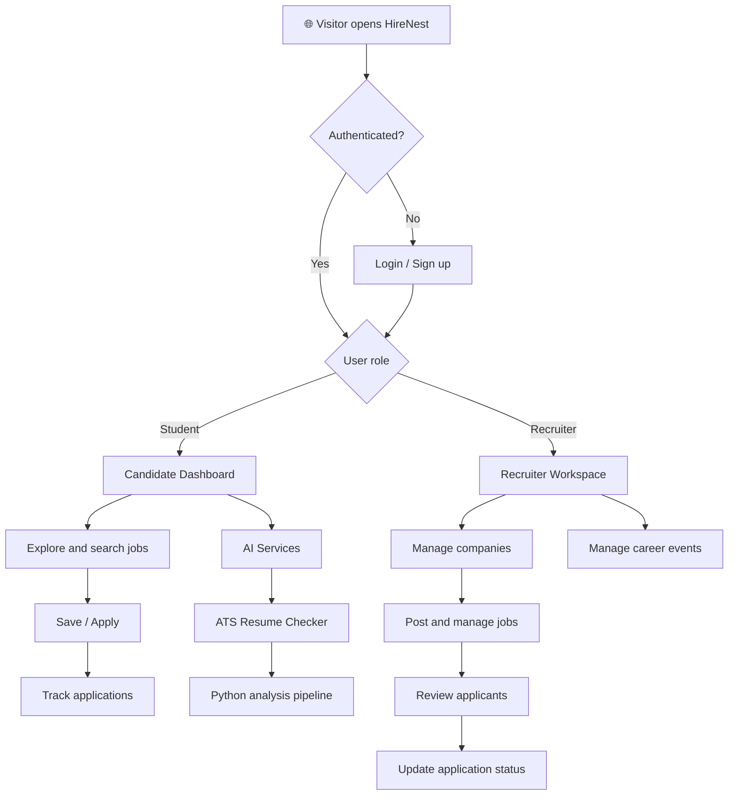
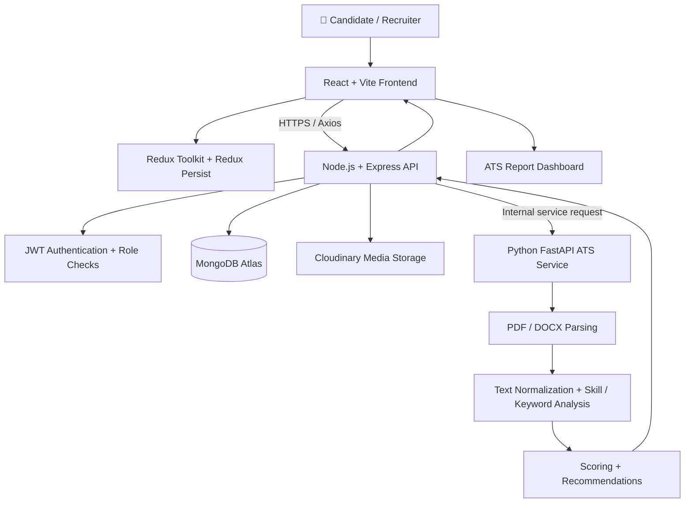
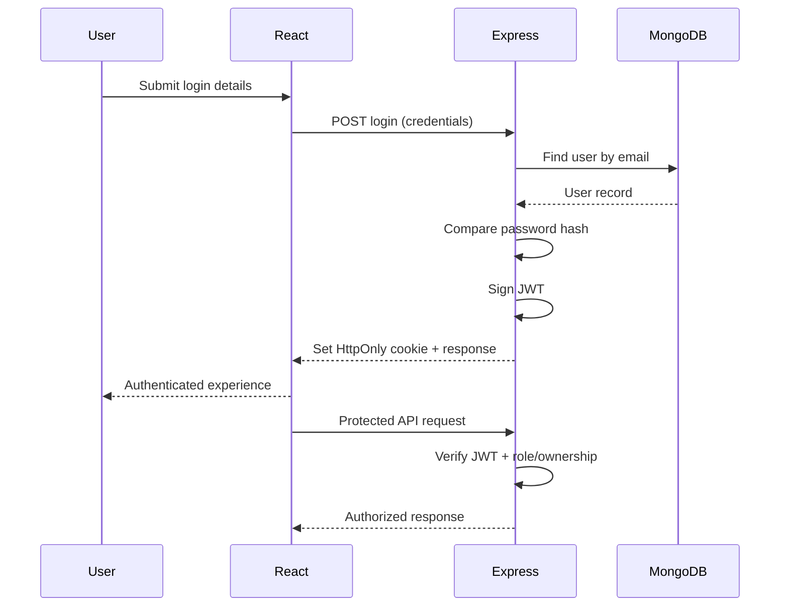
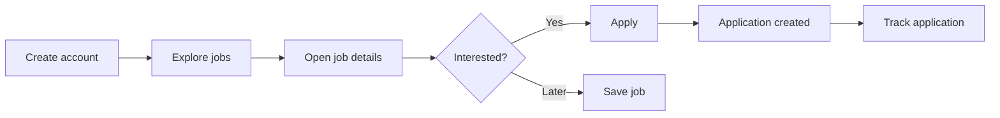
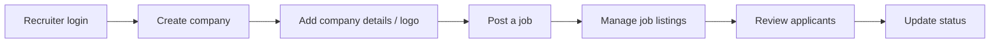
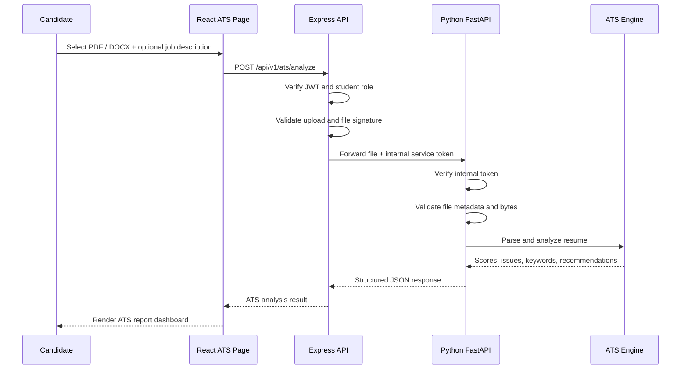
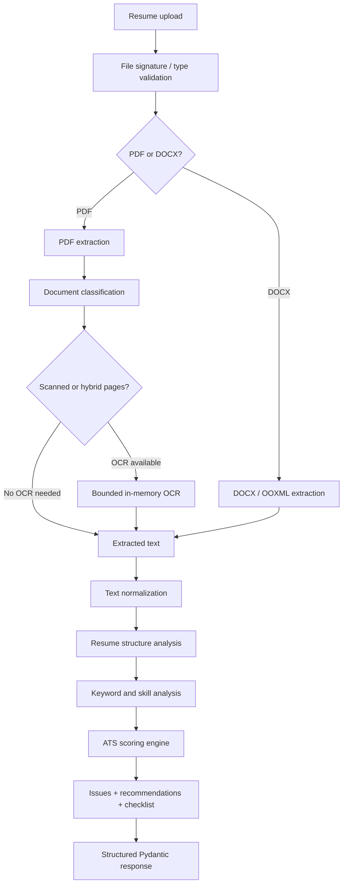
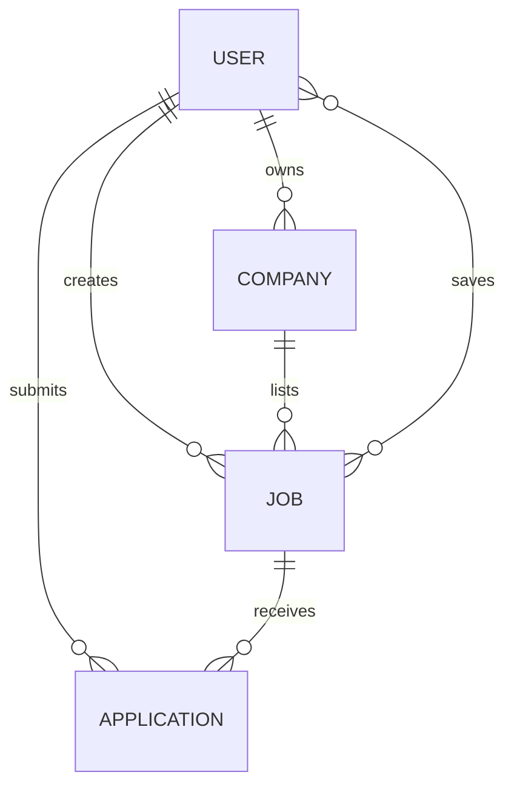

<div align="center">

# 🚀 HireNest
### Your Career. Your Connections. Your Next Opportunity.

**A modern, role-based job portal built to connect ambitious candidates with recruiters — powered by MERN and an intelligent Python ATS microservice.**

<p>
  <a href="https://hire-nest-liard.vercel.app"></a>
  <a href="https://github.com/KayasSecret/Job_Portal"></a>
  
  
</p>

<p><em>Discover opportunities. Showcase your skills. Make your next move.</em></p>

</div>

---

## ✨ Meet HireNest

HireNest is a full-stack recruitment platform designed around two core experiences:

- **For job seekers:** discover jobs, explore companies, save opportunities, apply with a resume, track applications, and use the ATS Resume Checker to improve resume readiness.
- **For recruiters:** create and manage company profiles, publish job openings, review applicants, update application statuses, and manage career events.

The goal is to bring the essential parts of a job-search and recruitment journey into one cohesive platform — with separate experiences for candidates and recruiters.

> **Project philosophy:** A job portal should do more than display vacancies. It should support the complete journey from discovering an opportunity to managing an application.

## 🎯 Explore the Project

| Destination | What you can explore |
|---|---|
| 🌐 [Live Application](https://hire-nest-liard.vercel.app) | Open the deployed HireNest experience |
| 💻 [GitHub Repository](https://github.com/KayasSecret/Job_Portal) | Explore the source code |
| 🧠 [ATS Service](./ai-services/ats-checker) | Explore the Python resume-analysis microservice |

---

## 🌈 Product Highlights

<table>
<tr>
<td width="50%">

### 👨‍🎓 Candidate Experience
- Browse and search job openings
- Explore job descriptions and company details
- Save jobs for later
- Apply to jobs with a resume on profile
- View applied jobs
- Access AI Services and ATS analysis
- Explore career events and event details

</td>
<td width="50%">

### 🧑‍💼 Recruiter Experience
- Create and manage company profiles
- Upload company logos
- Publish and manage job listings
- View applicants for posted jobs
- Review candidate profiles
- Update application statuses
- Create and manage events

</td>
</tr>
<tr>
<td width="50%">

### 🤖 ATS Resume Intelligence
- PDF and DOCX resume input
- Text extraction and normalization
- Resume structure analysis
- Skill and keyword detection
- Optional job-description matching
- Category-wise scoring
- Actionable issues and recommendations

</td>
<td width="50%">

### 🎨 Experience & Interface
- Responsive React interface
- Role-aware navigation and routes
- Redux Toolkit state management
- Persistent client state with Redux Persist
- Motion effects and interactive UI elements
- Toast feedback and reusable UI components

</td>
</tr>
</table>

---

## 🧭 How HireNest Works



## 🏗️ Architecture at a Glance

HireNest uses a **MERN-based core application** with a separate **Python FastAPI ATS microservice**.



### Technology Stack

| Layer | Technology | Responsibility |
|---|---|---|
| Frontend | React 18, Vite | Component-based user interface and build tooling |
| Routing | React Router | Client-side navigation and route composition |
| Styling | Tailwind CSS, Radix-based UI components | Responsive styling and interface primitives |
| Motion | Framer Motion | UI transitions and motion effects |
| State | Redux Toolkit, React Redux | Shared application state |
| Persistence | Redux Persist | Persist selected Redux state in browser storage |
| HTTP | Axios | Frontend-to-backend API requests |
| Backend | Node.js, Express | REST API and business logic |
| Database | MongoDB, Mongoose | Persistent application data and document models |
| Authentication | JWT, bcryptjs, cookie-based flow | User authentication and password hashing |
| Uploads | Multer | Multipart file handling |
| Media | Cloudinary | Company logos and uploaded media |
| ATS service | Python, FastAPI, Pydantic | Dedicated resume-analysis API |
| PDF processing | pypdf, pdfplumber, pypdfium2 | PDF text extraction and page processing |
| DOCX processing | python-docx | Word document parsing |
| OCR | pytesseract, Tesseract, Pillow | Optional OCR for scanned PDF pages |
| Text intelligence | spaCy, RapidFuzz | Skill/phrase matching and fuzzy matching utilities |
| Deployment | Vercel, Render, MongoDB Atlas | Frontend, backend/service hosting, and managed database |

---

## 🔐 Authentication & Role-Based Access

The application separates the candidate and recruiter journeys. The frontend route guard improves navigation and user experience, while the backend remains the actual security boundary.

### Authentication flow

1. A user registers or logs in through the React interface.
2. The Express API validates the request.
3. Passwords are stored as hashes using `bcryptjs` — not as plain text.
4. On successful login, the server issues a JWT.
5. The token is delivered through an HttpOnly cookie.
6. Protected API routes verify the token and identify the authenticated user.
7. Role and resource-ownership checks control access to protected actions.



### Important access rules

- Candidate-only ATS endpoints are protected by authentication and the `student` role.
- Recruiter actions are checked against the recruiter who owns the relevant company or job.
- A recruiter cannot apply for a job through the application controller.
- A candidate must have a resume URL on their profile before applying.
- Frontend route protection is not treated as a substitute for backend authorization.

---

## 💼 Core Workflows

### 1. Candidate journey



**What happens behind the scenes?**

- The candidate browses jobs returned by the Express API.
- Job records can be populated with related company information.
- Saving a job updates the candidate's saved-job data.
- Applying creates an application record linked to the candidate and job.
- The backend checks that the candidate has a resume URL and prevents duplicate applications.
- The recruiter who owns the job can review applicants and update application status.

### 2. Recruiter journey



A recruiter can create companies under their account. Job creation verifies that the selected company belongs to the logged-in recruiter. Applicant access and status updates are also checked against job ownership.

### 3. Events

The event module extends HireNest beyond job listings. It includes event discovery and details for users, alongside recruiter-side event management.

The event-related code includes event publishing/status concepts, RSVP handling, seat-capacity logic, and ownership-aware management. Exact behavior should be understood from the relevant event controller and model before changing the workflow.

---

## 🤖 ATS Resume Checker — The Engineering Highlight

The ATS Resume Checker is implemented as a separate Python FastAPI microservice rather than mixing Python parsing libraries into the Express application.

### Why a separate microservice?

- Keeps the main Node.js API focused on recruitment workflows.
- Uses Python's document-processing ecosystem where it is strongest.
- Separates ATS processing dependencies from the core application.
- Allows the analysis engine to be developed, tested, and deployed independently.
- Creates a clear service boundary between authentication/business logic and resume intelligence.

### ATS request flow



### Supported input

| Input | Supported |
|---|---|
| PDF resume | ✅ |
| DOCX resume | ✅ |
| Job description | Optional |
| Maximum upload size | 5 MB (configured default) |
| Maximum job-description length | 10,000 characters (configured default) |

### Analysis pipeline



### What does the ATS engine evaluate?

The response schema defines six score categories:

1. **Contact Information** — checks detectable contact details.
2. **Section Completeness** — looks for recognizable resume sections.
3. **Keyword Optimization** — evaluates skill and job-description keyword alignment.
4. **Experience Impact** — checks how clearly work and project contributions are expressed.
5. **Formatting & Readability** — considers whether document text can be extracted and interpreted.
6. **Content Quality** — evaluates content signals and writing quality.

The engine also returns:

- Overall ATS readiness score
- Optional job-match score when a job description is supplied
- Matched, partial, and missing keywords
- Detected skills
- Detected and missing resume sections
- Issues with severity levels
- Prioritized recommendations
- A practical pass/fail checklist
- Resume extraction statistics and warnings

> **Important distinction:** This is a rule-based and NLP-assisted resume analysis engine. It should not be described as a machine-learning model trained on recruiter hiring outcomes unless such a model and training process are actually implemented.

### PDF and DOCX processing details

**PDF**
- Uses `pdfplumber` and `pypdf` extraction paths.
- Includes layout-aware extraction logic for multi-column documents.
- Classifies document types, including text-based, scanned-image, and hybrid PDFs.
- Can use `pypdfium2`, Pillow, and Tesseract OCR for bounded scanned-page extraction when OCR is installed and enabled.

**DOCX**
- Uses `python-docx`.
- Reads paragraphs, tables, headers, and list/bullet information.
- Validates the OOXML ZIP container.
- Applies safeguards for archive entry count, uncompressed size, and disallowed embedded executable or macro-related content.

### ATS service endpoints

| Method | Endpoint | Purpose |
|---|---|---|
| GET | `/health` | Service health check |
| POST | `/api/v1/ats/analyze` | Internal resume-analysis endpoint |

The Python analysis endpoint requires the `X-Internal-Service-Token` header. The public-facing candidate request is routed through the authenticated Express ATS endpoints.

---

## 🗃️ Data Model & Relationships

The core backend uses MongoDB with Mongoose models. The main domain entities include:

| Entity | Purpose | Typical relationship |
|---|---|---|
| User | Candidate/recruiter account and profile | Owns companies, saved jobs, applications |
| Company | Recruiter-created company profile | Belongs to a recruiter; referenced by jobs |
| Job | Published job opening | Belongs to a company and recruiter |
| Application | Candidate's application to a job | References applicant and job |
| Event | Career event information | Managed by an authorized recruiter |



The diagram shows the conceptual relationships. MongoDB stores document references, and Mongoose `populate()` is used where related records are needed in API responses.

---

## 🧩 API Surface

The Express API is organized around versioned resource routes. The frontend builds endpoint URLs from the configured API base URL.

| Resource | Route prefix | Main responsibility |
|---|---|---|
| User | `/api/v1/user` | Registration, login, profile and user operations |
| Job | `/api/v1/job` | Job discovery and recruiter job management |
| Company | `/api/v1/company` | Company creation and management |
| Application | `/api/v1/application` | Apply, list applicants, update status |
| Event | `/api/v1/event` | Event discovery and management |
| ATS | `/api/v1/ats` | Authenticated ATS proxy and health check |

For exact HTTP methods, request bodies, and route-level middleware, refer to the corresponding route files under `Backend/routes/`. This README intentionally avoids inventing endpoint methods that may differ between source versions.

---

## 🖥️ Frontend Engineering

The frontend is built with React and Vite. The application uses React Router for navigation and Redux Toolkit for shared state.

### State organization

The Redux store combines feature slices for:

- `auth` — current user and loading state
- `job` — job listings, selected job, search and applied-job state
- `company` — company records and search state
- `application` — applicant data
- `event` — event listings and selected event

Redux Persist is configured to persist the root Redux state using browser local storage. The application is wrapped with Redux Provider and PersistGate.

### UI and interaction

The frontend dependency set includes Tailwind CSS, Radix UI primitives, Framer Motion, Lucide icons, and Sonner toast notifications. These support responsive layouts, reusable UI patterns, animations, iconography, and user feedback.

---

## 📁 Repository Structure

```text
Job_Portal/
│
├── Frontend/
│   ├── src/
│   │   ├── components/
│   │   │   ├── admin/
│   │   │   ├── ai-services/
│   │   │   ├── auth/
│   │   │   ├── events/
│   │   │   ├── home/
│   │   │   ├── shared/
│   │   │   └── ui/
│   │   ├── redux/
│   │   ├── utils/
│   │   ├── App.jsx
│   │   └── main.jsx
│   └── package.json
│
├── Backend/
│   ├── controllers/
│   ├── middlewares/
│   ├── models/
│   ├── routes/
│   ├── utils/
│   ├── index.js
│   └── package.json
│
└── ai-services/
    └── ats-checker/
        ├── app/
        │   ├── routes/
        │   ├── schemas/
        │   ├── services/
        │   ├── utils/
        │   ├── config.py
        │   └── main.py
        ├── tests/
        └── requirements.txt
```

---

## ⚙️ Run HireNest Locally

> The commands below assume the repository has the `Frontend`, `Backend`, and `ai-services/ats-checker` directories. Install the relevant runtimes before starting each service.

### Prerequisites

- Node.js and npm
- Python 3.10+ (use a version compatible with the installed dependencies)
- MongoDB Atlas account or a reachable MongoDB instance
- Cloudinary account for media upload features
- Tesseract OCR installation if scanned-PDF OCR is required

### 1. Clone the repository

```bash
git clone https://github.com/KayasSecret/Job_Portal.git
cd Job_Portal
```

### 2. Start the backend

```bash
cd Backend
npm install
npm run dev
```

Create a `Backend/.env` file and configure the environment variables expected by the backend source, including:

```env
MONGO_URI=your_mongodb_connection_string
JWT_SECRET=your_strong_jwt_secret
CLOUD_NAME=your_cloudinary_cloud_name
API_KEY=your_cloudinary_api_key
API_SECRET=your_cloudinary_api_secret
```

Also configure the backend port, frontend origin/CORS settings, cookie settings, and ATS service URL/secret according to the backend configuration in your checkout. Do not commit real credentials.

### 3. Start the frontend

Open a separate terminal:

```bash
cd Frontend
npm install
```

Create `Frontend/.env`:

```env
VITE_API_URL=http://localhost:8080
```

Use the actual backend port configured in your environment.

Then run:

```bash
npm run dev
```

### 4. Start the ATS microservice

Open another terminal:

```bash
cd ai-services/ats-checker
python -m venv .venv
```

Activate the environment:

**Windows PowerShell**
```powershell
.venv\Scripts\Activate.ps1
```

**macOS / Linux**
```bash
source .venv/bin/activate
```

Install dependencies:

```bash
python -m pip install -r requirements.txt
```

Configure the ATS service environment. The Node backend and Python service must use the same strong internal service secret.

```env
APP_ENV=development
HOST=127.0.0.1
PORT=8001
INTERNAL_SERVICE_SECRET=replace_with_a_long_random_secret
ALLOWED_ORIGINS=http://localhost:5173
```

Start FastAPI:

```bash
python -m uvicorn app.main:app --host 127.0.0.1 --port 8001 --reload
```

If your backend expects a different ATS service URL or module entrypoint, align the command and environment with the current source configuration.

---

## 🚀 Deployment Overview

The linked live application is hosted at Vercel. The repository architecture also supports a separately hosted Express backend, managed MongoDB, Cloudinary media storage, and a separately hosted ATS service.

| Component | Deployment responsibility |
|---|---|
| React frontend | Vercel |
| Express backend | Node-compatible host such as Render |
| MongoDB | MongoDB Atlas |
| Media assets | Cloudinary |
| Python ATS service | Python-compatible host such as Render |

### Production checklist

- Set production environment variables in the hosting provider.
- Use a strong, unique JWT secret.
- Use a strong, unique ATS internal service secret.
- Never rely on development fallback secrets in production.
- Restrict CORS to the intended frontend origin(s).
- Configure cookie `Secure`, `HttpOnly`, and appropriate `SameSite` behavior for the deployed domain setup.
- Ensure the Express service can reach the ATS service URL.
- Ensure ATS service authentication secret matches the Express configuration.
- Install Tesseract on the ATS host if OCR is expected to run.
- Configure MongoDB Atlas network access securely.
- Confirm Cloudinary credentials and upload behavior.
- Test login, logout, candidate application, recruiter ownership, and ATS upload on the deployed environment.

---

## 🛡️ Security & Reliability Notes

Security is layered across the client, Express API, and Python service.

| Area | Existing implementation observed | Production consideration |
|---|---|---|
| Passwords | `bcryptjs` password hashing | Keep hash configuration strong and never log credentials |
| Authentication | JWT in cookie-based flow | Validate expiry, cookie flags, and secret rotation |
| Authorization | Authentication and role middleware | Keep resource ownership checks on every sensitive operation |
| ATS access | Student-only Express routes | Keep backend authorization as the final gate |
| Internal ATS call | Shared secret header | Use a strong environment secret and private service networking |
| Upload validation | Extension, MIME, size, and magic-byte checks | Add rate limits and malware scanning where appropriate |
| PDF OCR | Bounded page/DPI/dimension/time settings | Monitor CPU/memory usage and queue heavy jobs |
| Data access | Mongoose queries and references | Add pagination, indexes, and query limits as usage grows |

### Important implementation caveat

The source contains development fallback values for the ATS internal service secret in both the Node controller and Python settings. These are convenient for local development but must be overridden with the same strong secret in every production environment. Never publish real secrets in this README or in Git history.

### Further improvements to consider

- Rate limiting and abuse protection for login and resume analysis.
- Centralized structured logging and monitoring.
- Pagination for job and applicant listing endpoints.
- Automated integration tests for cross-role authorization.
- Background processing for large or high-volume ATS workloads.
- Explicit API request/response documentation.
- Dependency scanning and regular security updates.
- Data retention and deletion policies for uploaded resumes.

---

## 🧪 Testing

The ATS microservice includes tests for its parsing and intelligence workflow. The repository's ATS tests exercise cases such as:

- DOCX analysis without a job description
- Separate job-match scoring when a job description is supplied
- Sparse resume issue detection
- Scanned-image PDF handling when OCR is unavailable

Run the ATS tests from the service directory:

```bash
python -m pytest -q
```

For the Express and React applications, run the scripts defined in each package's `package.json`. Add or extend tests when changing authentication, ownership checks, upload handling, or application workflows.

---

## 🎤 Explain HireNest in an Interview

> "HireNest is a full-stack job portal that I built to simplify the recruitment journey for both job seekers and recruiters. Instead of focusing only on job listings, I designed it around the complete workflow — candidates can discover opportunities, save jobs, apply, and track their applications, while recruiters can manage companies, publish jobs, review applicants, and organize career events.
>
> Technically, the core application follows the MERN stack. I used React with Vite on the frontend, Redux Toolkit for shared state management, Node.js and Express for REST APIs, and MongoDB with Mongoose for data persistence. Authentication is handled using JWT with an HttpOnly cookie-based flow, password hashing, and role-based authorization.
>
> One of the key engineering decisions was implementing the ATS Resume Checker as a separate Python FastAPI microservice. The Express backend authenticates the candidate and securely forwards the resume to the Python service. The service validates and parses PDF or DOCX files, performs text and keyword analysis, evaluates resume structure, and returns scores with actionable recommendations.
>
> I chose this separation because Python has a strong ecosystem for document processing and text analysis, while Node.js continues to handle the main application workflows. This keeps responsibilities modular and makes the ATS engine easier to evolve independently."

---

## 💡 Interview Questions You Should Be Ready For

<details>
<summary><strong>1. Why did you choose the MERN stack?</strong></summary>

I wanted a JavaScript-based stack for the main web application. React supports reusable UI components, Express and Node.js handle API/business logic, and MongoDB provides a flexible document database that fits the application's related entities and evolving profile data.
</details>

<details>
<summary><strong>2. Why did you build the ATS checker in Python instead of Node.js?</strong></summary>

The core application is already handled by Node.js, but Python has mature libraries for PDF/DOCX processing, OCR, and NLP-related analysis. A separate FastAPI service lets me use that ecosystem without coupling document-processing dependencies to the main backend.
</details>

<details>
<summary><strong>3. How do you prevent recruiters from applying to jobs?</strong></summary>

The application controller checks the authenticated user's role on the server and rejects recruiter accounts. This is important because frontend-only restrictions can be bypassed.
</details>

<details>
<summary><strong>4. How do you prevent duplicate applications?</strong></summary>

Before creating an application, the backend checks whether an application already exists for the same job and applicant. The controller also handles duplicate-key errors where a database uniqueness constraint is configured.
</details>

<details>
<summary><strong>5. How does the ATS upload stay protected?</strong></summary>

The Express ATS routes require authentication and the student role. The backend validates the uploaded file and forwards it to FastAPI with an internal service token. FastAPI verifies that token before processing the file.
</details>

<details>
<summary><strong>6. Is the ATS score generated by an LLM?</strong></summary>

The implemented ATS engine is based on deterministic scoring logic and NLP-assisted text/keyword analysis. I would not claim it is an LLM-based or trained predictive hiring model. Its purpose is to provide transparent resume-readiness signals and improvement suggestions.
</details>

<details>
<summary><strong>7. What happens if a resume is a scanned PDF?</strong></summary>

The PDF parser classifies the document. If OCR is enabled and Tesseract is available, selected pages can be rendered in memory and processed through OCR within configured resource limits. If OCR is unavailable, the service returns a clear parsing error rather than pretending it extracted text.
</details>

<details>
<summary><strong>8. How do you secure recruiter ownership?</strong></summary>

For sensitive operations, the backend compares the authenticated recruiter ID with the owner ID stored on the relevant company or job. A user should only manage resources they own.
</details>

---

## 🗺️ Suggested Live Demo Flow

A focused demo is more effective than randomly clicking through pages.

1. Open the live application and show the landing experience.
2. Log in as a candidate and browse/search jobs.
3. Open a job description and explain the apply/save workflow.
4. Show the candidate's applied jobs or profile.
5. Open AI Services and explain the ATS upload gate.
6. Demonstrate ATS analysis with a sample resume, if the service is available.
7. Switch to a recruiter account.
8. Show company management and job posting.
9. Open applicants and explain status management.
10. Finish by explaining the separate FastAPI service architecture.

**Demo tip:** Use prepared test accounts and sample data. Never expose passwords, private candidate resumes, API keys, or production environment variables during a screen-share.

---

## 👨‍💻 Project & Links

<div align="center">

### Built with curiosity. Designed for opportunity. Engineered for growth.

<a href="https://hire-nest-liard.vercel.app"></a>
<a href="https://github.com/KayasSecret/Job_Portal"></a>

**HireNest — Connecting Talent with Opportunity.**

</div>

---

<sub>Documentation note: This README is based on the repository structure and implementation details inspected for this project. Deployment settings, environment variable names, and route behavior should always be checked against the current source and hosting configuration before production use.</sub>
'''
out = "/mnt/data/HireNest_README.md"
pypandoc.convert_text(md, 'md', format='md', outputfile=out, extra_args=['--standalone'])
print(f"Created: {out}\nSize: {os.path.getsize(out):,} bytes")
